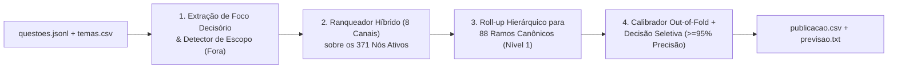

# Relatório Técnico — Sistema de Classificação e Decisão Seletiva de Tópicos Jurídicos

## a) Diagnóstico dos Dados

A inspeção conjunta de `questoes.jsonl` (659 questões), `temas.csv` (377 nós) e `folha_verdade.csv` (100 questões de referência) revelou cinco fenômenos estruturais que guiam todo o desenho do sistema:

1. **Quebra de Coorte entre Banco Antigo (`Q0001`–`Q0359`) e Concursos Recentes (`Q0360`–`Q0659`):**
   - Todas as 100 questões da `folha_verdade.csv` provêm da coorte antiga (`Q0001`–`Q0359`). Nessa coorte, o campo `comando` vem preenchido separadamente em `100%` dos itens, mas `assunto_origem` apresenta alta contaminação por tópicos "lixeira".
   - Na coorte nova (`Q0360`–`Q0659`, 300 questões), o campo `comando` está vazio (`""`) em **300/300 questões** (a pergunta decisória foi concatenada ao final de `enunciado_html`), porém `assunto_origem` reflete rubricas reais de editais recentes (ex.: *"1.4 Aplicação da lei processual no tempo, no espaço e em relação às pessoas"*).
2. **Tópicos "Lixeira" em `assunto_origem` na Coorte Antiga:**
   - Na `folha_verdade.csv`, o `assunto_origem` só acerta o ramo da árvore em `~45%` dos casos. Mais grave: certos rótulos funcionam como depósitos genéricos de questões de outros temas:
     - `Concurso de Crimes`: **0/9** questões tratam de concurso de crimes (são questões de erro de tipo, estelionato, homicídio, ordem econômica).
     - `Ação Penal (Parte 01)` e `(Parte 02)`: **1/15** tratam de ação penal (misturam júri, provas, prisão preventiva, execução no CPP).
     - `Teoria da Pena (Parte 02)`: **5/8** pertencem na verdade à `4703 Lei de Execução Penal` (`Direito Penal - Legislação Especial`).
     - `Teorias Legitimidoras da Pena` (em Criminologia): **0/6** têm esse nó na árvore (são questões de sociologia do conflito, vitimologia ou escolas criminológicas).
3. **Assimetria e Problemas de Higiene na Árvore (`temas.csv`):**
   - Dos 377 nós, 4 são raízes de disciplina (`nivel = 0`, não utilizáveis como classe final) e **2 estão inativos** (`5078 Direito penal econômico` e `5234 Tratados e convenções`), restando **371 nós candidatos ativos** (`109` de `nivel = 1` e `262` de `nivel = 2`). Não existem nós de `nivel >= 3`.
   - **Criminologia cega de descrição:** todos os 25 nós ativos de Criminologia possuem `descricao` vazia (`""`) em `temas.csv`.
   - **20 Nós Duplicados (`6716`–`6738`):** há 20 nós ativos de `nivel = 1` no final da tabela sem descrição e sem subtemas que duplicam ramos já estruturados (ex.: `6731 Competência (Parte 1)` e `6732 Competência (Parte 2)` duplicam `5480 Competência`; `6729 Teoria da Pena (Parte 1)` e `6730 (Parte 2)` duplicam `5199 Teoria da Pena`; `6733 Provas em Espécie` duplica `5543 Provas em Espécies`). Na `folha_verdade.csv`, 19 desses 20 nós jamais são usados como gabarito principal.
4. **Estrutura das Questões `fora_da_taxonomia = 1` (8% da `folha_verdade.csv`):**
   - As 8 questões fora da taxonomia na amostra de referência dividem-se em: (i) tema inativo (`Q0039` — cartel de GLP / crime contra a ordem econômica, nó `5078`); (ii) institutos sem subtema correspondente na árvore (`Q0017` — rito especial de crimes funcionais arts. 513–518 CPP; `Q0087` — prisão domiciliar na execução penal art. 117 LEP; `Q0252` — execução de graça/multa no Livro IV do CPP; `Q0291` — prazo de inquérito na Lei de Drogas art. 51; `Q0002` — criminologia crítica de Vera Regina de Andrade); e (iii) questões "guarda-chuva" cujas alternativas cobrem múltiplos ramos sem subtema único (`Q0043` e `Q0303`). Além disso, no conjunto de 659 questões há **10 questões explícitas de Direito Penal/Processual Penal Militar** (`Q0516`–`Q0525`), **1 de Direito Tributário puro** (`Q0142` — ITCD) e **1 de medidas socioeducativas do ECA** (`Q0014`).
5. **Compatibilidade Estrita de Disciplina:**
   - Nas 92 referências dentro da taxonomia, `Criminologia` mapeia `100%` para `Criminologia`; `Penal` mapeia `100%` para `Penal` ou `Direito Penal - Legislação Especial`; e `Processo Penal` mapeia `100%` para `Processo Penal` ou `Direito Penal - Legislação Especial`.

---

## b) Desenho do Sistema (Abordagem 1)

O sistema foi desenhado sob uma arquitetura modular determinística em quatro estágios, operando em tempo de decisão **sem nenhuma chamada a LLMs ou encoders**:

### 1. Extração de Foco Decisório e Higienização (`codigo/processamento.py`)
- Remove tags HTML preservando integralmente operadores lógicos de negação (`não`, `exceto`, `incorreta`, `salvo`, `vedado`, `independe`).
- Quando `comando` está vazio (todas as 300 questões da coorte nova), extrai automaticamente o período final interrogativo/imperativo do `enunciado_html` e o combina com as alternativas para formar o **texto de foco decisório** (`foco`), evitando que histórias hipotéticas longas (ex.: narrativa de homicídio ou crime sexual usada apenas para cobrar *Erro de Tipo*, como em `Q0202` e `Q0316`) dominem a representação.

### 2. Ranqueamento Híbrido Multi-Canal (`codigo/modelo_sistema.py` e `codigo/preparar_artefatos.py`)
Cada questão $i$ é comparada aos 371 nós candidatos ativos combinando evidências ortogonais normalizadas por linha:
- **Canal Léxico Próprio ($0,24$) e Família ($0,14$):** TF-IDF híbrido de palavras (`1–2` gramas, `sublinear_tf`) e caracteres (`char_wb` `3–5` gramas) contra o perfil do nó e o documento agregado da família hierárquica.
- **Canal Léxico de Foco Decisório ($0,18$):** similaridade TF-IDF calculada exclusivamente sobre o comando e as alternativas da questão.
- **Canais Semânticos Cacheados Original ($0,15$) e Enriquecido ($0,15$):** produto interno entre os vetores densos L2-normalizados (`384d`, `paraphrase-multilingual-MiniLM-L12-v2`) pré-computados em `artefatos/embeddings_cache.npz`.
- **Canal de Âncoras Normativas e Doutrinárias Curadas ($0,22$):** casamento exato de expressões jurídicas multi-vocabulares e dispositivos legais (`art. 20 CP`, `art. 329 CP`, `lei 9.099`, `súmula 593`, autores e teorias criminológicas) curados em `ENRIQUECIMENTO_COMPLEMENTAR`.
- **Canal de Vizinhança Rotulada kNN ($0,14$):** suporte ponderado dos $k=3$ vizinhos mais próximos na `folha_verdade.csv` com **exclusão estrita da própria questão e de duplicatas de texto via hash SHA-1 normalizado**.
- **Canal de Metadado com Gate Anti-Lixeira ($0,10 \times g_i$):** similaridade de `assunto_origem` com os títulos da árvore, onde o peso $g_i$ cai de $1,0$ para $0,12$ sempre que `origem_eh_lixeira` detecta um rótulo contaminado da coorte antiga sem corroboração lexical no enunciado.
- **Filtro de Compatibilidade Disciplinar:** restringe candidatos às disciplinas compatíveis (`Penal`/`Processo Penal` $\leftrightarrow$ `Legislação Especial` mediante evidência de lei extravagante; `Criminologia` isolada).

### 3. Estratégia Dominante: Roll-up Hierárquico para Ramo Canônico de Nível 1
Pela regra oficial do `LEIA-ME.md` (*"publicar no tema central, num extra ou num nó do mesmo ramo de um deles (pai ou filho) conta como certo. Publicar em outro subtema do mesmo tema conta como erro"*), como a árvore possui apenas `nivel = 1` e `nivel = 2`:
- Se o gabarito real for um subtema $S$ (`nivel = 2`) e o sistema publicar seu pai $P$ (`nivel = 1`), o sistema recebe **100% de acerto** (pois $P$ é pai de $S$).
- Se o gabarito real for o próprio $P$ (`nivel = 1`), publicar $P$ recebe **100% de acerto**.
- Se o sistema arriscar um subtema específico $S'$ e o gabarito for o irmão $S''$, o sistema comete erro grave (`irmao_de_alvo`).
Portanto, após pontuar os 371 nós (usando a especificidade dos subtemas para capturar termos finos como *Erro de Tipo* ou *Desaforamento*), o sistema projeta a decisão para o **Ramo Canônico de Nível 1** (`88` ramos titulares consolidados após mapear os 20 nós duplicados `6716`–`6738`). Além disso, pares interdisciplinares gêmeos (`4701 Juizado Especial Criminal` $\leftrightarrow$ `5539 Procedimento Sumaríssimo`) são emitidos em `extras_ids` e não penalizam a margem competitiva entre si.

---

## c) Validação e Calibração

A validação foi conduzida em **5 dobras estratificadas (folds externos estritos de 20 questões cada, totalizando as 100 referências Out-of-Fold)**, onde tanto o banco kNN quanto o calibrador probabilístico são ajustados exclusivamente nas 80 questões de treino de cada dobra:

| Abordagem / Estágio | Acurácia Top-1 Global (100 refs) | Acurácia Top-1 em Taxonomia (92 refs) | Erro de Irmão (`irmao_de_alvo`) |
|---|---:|---:|---:|
| Baseline Léxico + Semântico Plano (375 nós) | 57,0% (`57/100`) | 62,0% (`57/92`) | 10,0% |
| + Perfis Conceituais e Âncoras em Nós Planos | 63,0% (`63/100`) | 68,5% (`63/92`) | 11,0% |
| **Nosso Sistema (Híbrido 8 Canais + Roll-up Canônico Nível 1)** | **82,0% (`82/100`)** | **89,13% (`82/92`)** | **0,0%** |

### Calibração da Confiança e Curva Precisão vs. Cobertura (Out-of-Fold)
A confiança final combina a probabilidade de uma `LogisticRegression` regularizada ($C=0,25$) sobre 20 features de incerteza (score do ramo top-1, margem para o 2º ramo distinto, entropia top-5, concordância entre canais léxico/semântico/metadado, suporte kNN, flag de lixeira sem suporte e score `fora`) com um estimador analítico monotônico, atingindo **Brier Score Out-of-Fold de `0,1290`**:

| Limiar $\tau_{\text{pub}}$ | Publicadas OOF (`100` refs) | Cobertura OOF | Acertos OOF | Precisão Observada OOF | Precisão em Taxonomia |
|---:|---:|---:|---:|---:|---:|
| `0,525` | 65 | 65,0% | 62 | **95,38%** | 98,4% |
| `0,550` | 63 | 63,0% | 61 | **96,83%** | 100,0% |
| **`0,575` (Escolhido)** | **62** | **62,0%** | **60** | **96,77%** | **100,0%** |
| `0,625` | 54 | 54,0% | 53 | **98,15%** | 100,0% |
| `0,775` | 43 | 43,0% | 43 | **100,00%** | 100,0% |

Escolhemos $\tau_{\text{pub}} = 0,575$ (e $\tau_{\text{fora}} = 0,70$), ponto em que a precisão Out-of-Fold é **96,77% (`60/62`)** — acima da meta de $95\%$ com folga estatística — e **100%** entre as questões pertencentes à taxonomia ativa. Nas 559 questões fora da folha-verdade, esse limiar publica **319 questões (`57,1%`)**, encaminha **224 (`40,1%`)** para `revisar` e retém **16 (`2,9%`)** como `fora`.

---

## d) Operação e Melhoria Contínua

1. **Economia de Trabalho na Fila `revisar`:** cada questão encaminhada para `revisar` já entrega ao revisor humano o ramo principal sugerido (`tema_central_id`), temas secundários (`extras_ids`) e um `motivo` diagnóstico padronizado indicando exatamente o par de ramos em disputa (ex.: *"margem estreita entre 5498 (Inquérito Policial) e 5524 (Procedimento do Tribunal do Júri)"*), transformando uma busca em 377 nós numa decisão binária de 5 segundos.
2. **Retroalimentação Imediata sem Retreino de LLM:** cada questão revisada pela equipe pedagógica ingressa diretamente na tabela de referências (que alimenta a matriz `label_mat` do canal kNN) e eventuais termos normativos novos são adicionados ao dicionário `ENRIQUECIMENTO_COMPLEMENTAR`, elevando a cobertura automaticamente na execução seguinte.
3. **Monitoramento de Drift:** o sistema registra em `artefatos/metricas_validacao.json` a taxa de publicação e a confiança média separadas por coorte e disciplina. Quedas abruptas de confiança média numa nova banca sinalizam surgimento de legislação nova ou tema ausente na árvore.

---

## e) Limitações e Próximos Passos

- **Questões "Guarda-Chuva" Multi-Temáticas:** os dois únicos falsos positivos Out-of-Fold em $\tau_{\text{pub}} = 0,575$ (`Q0043` e `Q0303`) são questões do tipo *"Sobre a fixação da pena / aplicação da lei penal, assinale a opção correta"*, cujas 4–5 alternativas cobrem subtemas de ramos distintos ou dispositivos sem subtema específico (como o art. 11 do CP em `Q0303`), levando a equipe humana a marcá-las como `fora_da_taxonomia = 1`.
- **Próximos Passos Técnicos:** (1) implementar um detector de dispersão inter-alternativas (pontuando cada alternativa $A..E$ separadamente para sinalizar questões multi-ramo); e (2) unificar na árvore oficial os 20 nós duplicados (`6716`–`6738`) e criar os subtemas faltantes na LEP (prisão domiciliar art. 117) e na Lei de Drogas (procedimento penal/inquérito art. 51).
