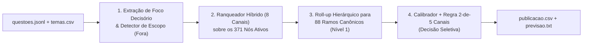

# Relatório Técnico — Sistema de Classificação e Decisão Seletiva de Tópicos Jurídicos

## a) Diagnóstico dos Dados

A inspeção de `questoes.jsonl` (659 questões), `temas.csv` (377 nós) e `folha_verdade.csv` (100 questões de referência) revelou cinco características estruturais que determinam o desenho e os limites estatísticos do sistema:

1. **Mudança de Coorte entre Banco Antigo (`Q0001`–`Q0359`) e Concursos Recentes (`Q0360`–`Q0659`):**
   - Todas as 100 questões da `folha_verdade.csv` pertencem à coorte antiga (`Q0001`–`Q0359`). Nessa coorte, o campo `comando` vem preenchido separadamente em `100%` dos itens, mas `assunto_origem` apresenta forte contaminação por tópicos genéricos ("lixeiras").
   - Na coorte nova (`Q0360`–`Q0659`, 300 questões), o campo `comando` está vazio (`""`) em **300/300 questões** (a frase interrogativa foi incorporada ao final de `enunciado_html`), enquanto `assunto_origem` traz rubricas de editais recentes (ex.: *"1.4 Aplicação da lei processual no tempo, no espaço e em relação às pessoas"*). Como não há questões de `Q0360`–`Q0659` na `folha_verdade.csv`, qualquer estimativa de precisão para essa coorte envolve extrapolação sob mudança de distribuição.
2. **Tópicos "Lixeira" em `assunto_origem` na Coorte Antiga:**
   - Na `folha_verdade.csv`, `assunto_origem` coincide com o ramo correto da árvore em apenas `~45%` dos casos e contém rótulos que funcionam como depósitos de outros assuntos: `Concurso de Crimes` (**0/9** tratam de concurso de crimes), `Ação Penal (Parte 01/02)` (**1/15** tratam de ação penal), `Teoria da Pena (Parte 02)` (**5/8** pertencem na verdade à `4703 Lei de Execução Penal`) e `Teorias Legitimidoras da Pena` (**0/6** têm esse nó na árvore).
3. **Estrutura e Higiene da Árvore (`temas.csv`):**
   - Dos 377 nós, 4 são raízes de disciplina (`nivel = 0`, não utilizáveis como classe final) e **2 estão inativos** (`5078 Direito penal econômico` e `5234 Tratados e convenções`), restando **371 nós candidatos ativos** (`109` de `nivel = 1` e `262` de `nivel = 2`; não há `nivel >= 3`).
   - Todos os 25 nós ativos de `Criminologia` possuem `descricao` vazia (`""`).
   - Existem **20 nós ativos de `nivel = 1` no final da tabela (`6716`–`6738`)** sem descrição e sem subtemas que duplicam ramos já estruturados (ex.: `6731/6732 Competência (Parte 1/2)` duplicam `5480 Competência`; `6729/6730 Teoria da Pena (Parte 1/2)` duplicam `5199 Teoria da Pena`; `6733 Provas em Espécie` duplica `5543 Provas em Espécies`). Na `folha_verdade.csv`, 19 desses 20 nós têm zero ocorrências (a única exceção é `6734` em `Q0138`, acompanhado do extra `5205`).
4. **Questões `fora_da_taxonomia = 1` (8% da `folha_verdade.csv`):**
   - As 8 questões fora da taxonomia na referência dividem-se em: (i) tema inativo (`Q0039` — cartel de GLP / ordem econômica, nó `5078`); (ii) institutos sem subtema correspondente na árvore (`Q0017` — rito especial de crimes funcionais arts. 513–518 CPP; `Q0087` — prisão domiciliar na execução penal art. 117 LEP; `Q0252` — execução de graça e parcelamento de multa no Livro IV do CPP; `Q0291` — prazo de inquérito na Lei de Drogas art. 51; `Q0002` — criminologia crítica de Vera Regina de Andrade); e (iii) questões "guarda-chuva" cujas alternativas cobrem múltiplos ramos ou dispositivos ausentes (`Q0043` e `Q0303`). Nas 659 questões totais, há ainda **10 questões explícitas de Direito Penal/Processual Penal Militar** (`Q0516`–`Q0525`), **1 de Direito Tributário puro** (`Q0142` — ITCD) e **1 de medidas socioeducativas do ECA** (`Q0014`).
5. **Compatibilidade de Disciplina:**
   - Nas 92 referências em taxonomia, `Criminologia` mapeia `100%` para `Criminologia`; `Penal` mapeia `100%` para `Penal` ou `Direito Penal - Legislação Especial`; e `Processo Penal` mapeia `100%` para `Processo Penal` ou `Direito Penal - Legislação Especial`.

---

## b) Desenho do Sistema

O sistema opera em quatro estágios determinísticos, **sem nenhuma chamada a LLMs ou encoders em tempo de decisão**:

### 1. Extração de Foco Decisório e Higienização (`codigo/sistema/processamento.py`)
- Remove tags HTML preservando operadores de negação (`não`, `exceto`, `incorreta`, `salvo`, `vedado`, `independe`).
- Quando `comando` está vazio (coorte nova), extrai o período final interrogativo/imperativo de `enunciado_html` e o combina com as alternativas para compor o **foco decisório** (`foco`), reduzindo a contaminação de narrativas longas cujo comando cobra outro instituto (ex.: narrativa de crime sexual ou homicídio cujo comando cobra *Erro de Tipo*, art. 20 do CP, como em `Q0202` e `Q0316`).

### 2. Ranqueamento Híbrido Multi-Canal com Complexidade $O(N \cdot M_{\text{ref}})$ (`codigo/sistema/modelo_sistema.py`)
Cada questão $i$ é comparada aos 371 nós ativos combinando oito sinais normalizados por linha:
- **Léxico Próprio ($0,24$), Léxico Família ($0,14$) e Léxico de Foco Decisório ($0,18$):** TF-IDF de palavras (`1–2` gramas, `sublinear_tf`) e caracteres (`char_wb` `3–5` gramas).
- **Semântico Original ($0,15$) e Semântico Enriquecido ($0,15$):** cosseno sobre vetores `384d` (`paraphrase-multilingual-MiniLM-L12-v2`) pré-computados em `codigo/artefatos/embeddings_cache.npz`.
- **Âncoras Normativas e Doutrinárias Curadas ($0,22$):** casamento de expressões multi-vocabulares e artigos legais (`art. 20 CP`, `art. 329 CP`, `lei 9.099`, autores de Criminologia) em `ENRIQUECIMENTO_COMPLEMENTAR`.
- **Suporte de Vizinhança kNN ($0,14$) em Memória $O(N \cdot M_{\text{ref}})$:** em vez de construir uma matriz $N \times N$ entre todas as questões, calcula apenas a similaridade $N \times M_{\text{ref}}$ (`659 x 100`) contra as referências rotuladas, com exclusão estrita da própria questão e de duplicatas de texto via hash SHA-1.
- **Metadado com Gate Anti-Lixeira ($0,10 \times g_i$):** similaridade de `assunto_origem` com títulos da árvore, reduzindo $g_i$ de $1,0$ para $0,12$ quando `origem_eh_lixeira` detecta rótulo contaminado sem corroboração lexical.

### 3. Roll-up Hierárquico para Ramo Canônico de Nível 1 e Trade-off Pedagógico
Pela regra oficial do `LEIA-ME.md` (*"publicar no tema central, num extra ou num nó do mesmo ramo de um deles (pai ou filho) conta como certo. Publicar em outro subtema do mesmo tema conta como erro"*):
- Projetar a predição do subtema vencedor (`nivel = 2`) para seu ramo canônico de `nivel = 1` (`88` ramos titulares após consolidar os 20 nós duplicados `6716`–`6738`) é aceito em **92/92 (`100%`)** das referências em taxonomia e zera os erros de subtema irmão (`irmao_de_alvo`).
- **Trade-off pedagógico:** publicar no `nivel = 1` protege o aluno de receber uma questão classificada num subtema irmão incorreto (o que ocorre frequentemente quando as alternativas A–E cobrem vários subtemas do mesmo tema), mas sacrifica a granularidade de subtema (`nivel = 2`). Para mitigar essa perda na operação, o método `ranquear_questao` já retém o campo `no_especifico_top1` (o subtema de `nivel = 2` mais pontuado dentro do ramo), que pode ser exibido na interface como subtag informativa sem risco de erro contratual.

---

## c) Validação, Calibração e Limites de Generalização

### 1. Resultados Verificáveis na `folha_verdade.csv` (5 Dobras Estritas)
Em 5 dobras estratificadas (onde cada dobra ajusta o banco kNN e a `LogisticRegression` nas 80 questões de treino e avalia nas 20 externas):

| Abordagem / Estágio | Acurácia Top-1 Global (100 refs) | Acurácia Top-1 em Taxonomia (92 refs) | Erro de Irmão (`irmao_de_alvo`) |
|---|---:|---:|---:|
| Baseline Léxico + Semântico Plano (375 nós) | 57,0% (`57/100`) | 62,0% (`57/92`) | 10,0% |
| + Perfis Conceituais e Âncoras em Nós Planos | 63,0% (`63/100`) | 68,5% (`63/92`) | 11,0% |
| **Nosso Sistema (Híbrido 8 Canais + Roll-up Nível 1)** | **82,0% (`82/100`)** | **89,13% (`82/92`)** | **0,0%** |

Para publicar (`decisao = publicar`), `decidir_questao` exige simultaneamente: (i) `score_fora < 0,70`; (ii) confiança calibrada `conf >= 0,575` (combinação $0,45 \cdot p_{\text{LR}} + 0,55 \cdot p_{\text{analítica}}$, com **Brier Score OOF = `0,1249`**); e (iii) **`tem_convergencia_minima == True`** (pelo menos 2 das 5 famílias de evidência — léxico top-2, semântico top-2, metadado não-lixeira, âncora normativa ou vizinhança kNN $\ge 0,12$ — corroborando o ramo líder):

| Limiar $\tau_{\text{pub}}$ | Publicadas OOF (`100` refs) | Cobertura OOF | Acertos OOF | Precisão Observada OOF | IC 95% de Wilson |
|---:|---:|---:|---:|---:|---:|
| `0,500` | 67 | 67,0% | 64 | **95,52%** | `87,64%–98,47%` |
| `0,550` | 63 | 63,0% | 61 | **96,83%** | `89,14%–99,13%` |
| **`0,575` (Escolhido)** | **62** | **62,0%** | **60** | **96,77%** | **`88,98%–99,11%`** |
| `0,625` | 56 | 56,0% | 55 | **98,21%** | `90,55%–99,68%` |
| `0,775` | 43 | 43,0% | 43 | **100,00%** | `91,80%–100,00%` |

### 2. Análise Crítica da Incerteza Amostral, Otimismo de Seleção e Transportabilidade
Separamos rigorosamente o que os dados demonstram do que permanece como risco sob incerteza:
1. **Incerteza amostral ($n=62$) e margem de apenas 1 erro:** em $\tau_{\text{pub}} = 0,575$, acertamos `60/62` (`96,77%`), uma margem pontual de `+1,77 p.p.` sobre a meta de `95%` (em $n=62$, $59/62 = 95,16\%$ e $58/62 = 93,55\%$, logo caberia apenas **mais 1 erro** além dos 2 já ocorridos para permanecer $\ge 95\%$). O intervalo de Wilson de 95% é **`[88,98%, 99,11%]`** (mesmo $62/62$ teria limite inferior de `94,17%`, pois seriam necessários $73/73$ acertos sem erro para o limite inferior de Wilson atingir $95\%$). Esse intervalo descreve exclusivamente a variância amostral interna de $n=62$, não incorporando automaticamente a seleção do modelo nem a mudança de coorte.
2. **Otimismo de seleção pós-hoc (*post-selection bias*):** embora cada dobra exclua as 20 questões externas do ajuste do kNN e da regressão logística, a arquitetura, o dicionário de âncoras e o limiar $\tau_{\text{pub}} = 0,575$ foram refinados após inspecionar os erros nas 100 referências. Por isso, em `previsao.txt`, adotamos uma previsão prudencial de `0.95`: o desconto de `1,5 p.p.` sobre os `96,77%` observados é uma **hipótese de julgamento**, sem validação empírica de que compense exatamente o otimismo de seleção.
3. **Transportabilidade para a Coorte Nova (`Q0360`–`Q0659`):**
   - *O que é verificável:* executamos em `avaliar_simulacao_formato_coorte_nova` uma ablação estrutural nas 100 referências concatenando `comando` ao final de `enunciado_html` e esvaziando `comando = ""`. O sistema manteve **`82/100` acertos Top-1** e **`61/63` (`96,83%`) de precisão OOF**. Ressaltamos que esse teste valida o extrator léxico/estrutural `extrair_foco_e_corpo`, mas mantém os vetores MiniLM pré-computados fixos.
   - *O que é hipótese plausível (não comprovável sem gabarito de `Q0360`–`Q0659`):* nas 559 questões fora da folha, o sistema publicou **302 questões (`54,03%`)**, sendo `109/259` (`42,1%`) na coorte antiga e `193/300` (`64,3%`) na coorte nova. Entre as publicadas da coorte nova, `63,2%` têm concordância simultânea `top-2` entre léxico e semântico (`41,5%` em `top-1`) e os rótulos de origem vêm de editais recentes sem os marcadores `"Parte 01/02"`. Contudo, como os canais léxico, semântico e de âncoras leem o mesmo texto-base, eles não são estatisticamente independentes e podem convergir no mesmo erro caso o enunciado descreva um cenário longo de um tema e cobre outro nas alternativas.

---

## d) Operação em Escala (50.000 Questões/Semana), Custos e Retreino

### 1. Projeção de Memória, Tempo e Custo para 50.000 Questões por Semana
Substituímos a comparação par-a-par $N \times N$ por $N \times M_{\text{ref}}$ (`sim_q_ref_hibrida` tem dimensão `659 x 100`). A função `benchmark_escala_50k` (`artefatos/metricas_validacao.json`) mede o tempo e o tamanho em bytes das matrizes densas no lote real de $N=659$ e calcula uma **projeção analítica linear** para **50.000 questões inéditas/semana** (não executamos 50 mil questões reais; os tempos de codificação CPU/GPU, custos de nuvem e o consumo total de RAM do processo abaixo são estimativas de engenharia):

| Etapa Operacional (Lote de 50.000 questões/semana) | Medição ($N=659$) e Estimativa Projetada ($N=50.000$) | Tamanho das Matrizes Densas (excluindo overhead do processo Python/TF-IDF esparso) | Custo Semanal Estimado |
|---|---|---|---|
| **1. Codificação Vetorial (`MiniLM-L12-v2` 384d)** para 50k novas questões (`fastembed` ONNX) | *Estimativa:* ~8 a 10 min em CPU 4-vCPU (ou ~45s em 1 GPU T4) | *Estimativa de RSS do modelo ONNX + batch:* `~450 MB` | **R$ 0,00** de API externa (*estimativa:* ~R$ 2,00 em computação cloud batch) |
| **2. Limpeza HTML, TF-IDF (60k features), Âncoras e Decisão (`reproduzir.py`)** | *Medido em $N=659$:* `12,48s` totais (`2,61s` na inferência). *Extrapolação linear p/ 50k:* **~15,8 min** em 1 core CPU (*estimativa:* ~3,5 min em 4 cores com lotes de 5.000) | Matrizes densas medidas em $N=659$: `8,68 MB`. Projeção analítica p/ 50k: matriz kNN $50\text{k} \times 100$ = **`19,07 MB`**; soma das matrizes densas em lotes de 5k = **`65,8 MB`** (`658,4 MB` sem batching, fora matrizes esparsas TF-IDF e interpretador) | **R$ 0,00** de API externa (*estimativa:* ~R$ 1,50 em CPU cloud) |
| **3. Revisão Humana da Fila `revisar` (~43% projetado = ~21.500 questões se todo o lote for inédito)** | *Estimativa:* com sugestão `top-1` vs. `top-2` e `motivo` (~15s/questão vs. ~90s do zero) $\rightarrow$ **~89 horas-professor/semana** se 100% revisado | N/A | **Custo dominante da operação** (exige priorização por demanda de acesso dos alunos) |

### 2. Fluxo Operacional e Frequência de Atualização / Retreino
Para que a fila humana não se torne gargalo em 50.000 questões/semana, as `~21.500` questões em `revisar` são ordenadas por volume de visualizações dos alunos e menor margem `margin12`:
- **Atualização Semanal (Incremental, sem retreino de redes):** as questões validadas pela equipe pedagógica na semana são anexadas à base de referência (`folha_verdade`), expandindo $M_{\text{ref}}$ (ex.: de 100 para 1.000–3.000 âncoras estratificadas) e atualizando o dicionário `ENRIQUECIMENTO_COMPLEMENTAR`.
- **Recalibração Mensal (ou a cada 500 novas referências auditadas):** reajuste da `LogisticRegression` de calibração e verificação da curva precisão-cobertura em validação cruzada agrupada por banca/coorte.
- **Auditoria Contínua de Amostra Publicada (Semanal, 50 questões sorteadas de `publicar`):** amostragem cega de 50 questões publicadas da semana para monitorar se a precisão real permanece $\ge 95\%$ sob novas bancas.

---

## e) Limitações e Próximos Passos

1. **Questões "Guarda-Chuva" Multi-Temáticas:** os dois únicos erros Out-of-Fold em $\tau_{\text{pub}} = 0,575$ (`Q0043` e `Q0303`) são questões de enunciado genérico (*"Sobre a fixação da pena / aplicação da lei penal, assinale a opção correta"*) cujas alternativas A–E cobrem múltiplos ramos ou dispositivos sem subtema específico (art. 11 do CP em `Q0303`), marcadas como `fora_da_taxonomia = 1` pela equipe.
2. **Próximos Passos:** (i) pontuar cada alternativa individualmente para detectar dispersão multi-ramo; (ii) amostrar e rotular ~50 questões da coorte nova (`Q0360`–`Q0659`) para eliminar a extrapolação de coorte na calibração; e (iii) higienizar `temas.csv` desativando os 20 nós duplicados (`6716`–`6738`) e criando os subtemas faltantes na LEP (art. 117) e na Lei de Drogas (art. 51).
